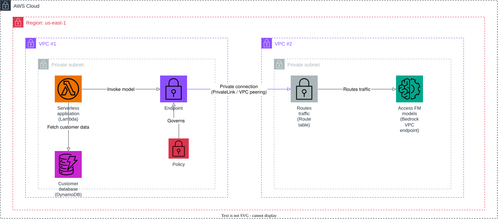

# AWS Project: Set Up Private Access to Foundation Models

This project sets up private, internet-free network access to foundation models from inside a VPC using VPC interface endpoints and PrivateLink-style connectivity, so that no application traffic traverses the public internet. A serverless application in one VPC reaches a customer database directly and reaches foundation models in a second VPC entirely over private AWS network paths.

1. a serverless application (Lambda), running in VPC #1's private subnet, fetches customer data from the customer database (DynamoDB);
2. the serverless application connects to an endpoint — a VPC interface endpoint governed by a policy that restricts which principals and actions may use it;
3. the endpoint establishes a private connection (modeled with VPC peering, standing in for PrivateLink) across to VPC #2;
4. in VPC #2's private subnet, the private connection routes traffic through a route table to the "Access FM models" VPC interface endpoint — a Bedrock VPC endpoint — so the serverless application can invoke foundation models without ever traversing the public internet.

## Prerequisites

- Docker
- Terraform 1.5+
- AWS CLI

## Start Floci

```bash
docker compose up -d
```

## Apply Terraform

```bash
terraform init
terraform apply
```

Applying this configuration creates:

- two VPCs, each with one private subnet (no internet gateway, no public route);
- a VPC peering connection and the routes in each private subnet's route table that model the private, cross-VPC connection;
- a VPC interface endpoint in VPC #1 ("Endpoint"), with an endpoint policy that only allows the serverless application's IAM role to invoke foundation models through it;
- a VPC interface endpoint in VPC #2 ("Access FM models") for the `bedrock-runtime` service, with a matching restrictive policy;
- security groups that only allow HTTPS between the serverless application, the endpoints, and the private connection;
- the customer database (DynamoDB table) and sample customer records;
- the serverless application (Lambda function), deployed inside VPC #1's private subnet with least-privilege IAM permissions for DynamoDB and Bedrock.

## Architecture



The diagram source is a real, editable [draw.io](https://www.drawio.com/) file at [docs/architecture.drawio](docs/architecture.drawio), generated programmatically with the [drawpyo](https://github.com/MerrimanInd/drawpyo) Python library. Open the `.drawio` file directly on GitHub or with the draw.io desktop app / [app.diagrams.net](https://app.diagrams.net/) to edit it.

To regenerate the diagram (`.drawio` source + the `.svg`/`.png` embedded above) after changing the architecture:

```bash
python3 -m venv .diagram-venv
.diagram-venv/bin/pip install drawpyo
.diagram-venv/bin/python scripts/generate_diagram.py

# rasterize the .drawio file to svg/png (used by the README) via headless draw.io
docker run --rm -v "$PWD/docs":/data -w /data rlespinasse/drawio-export -f svg -o . --output-mode relative --remove-page-suffix .
docker run --rm -v "$PWD/docs":/data -w /data rlespinasse/drawio-export -f png -o . --output-mode relative --remove-page-suffix -t .
```

## Test the serverless application

```bash
FUNCTION_NAME=$(terraform output -raw lambda_function_name)

aws --endpoint-url http://localhost:4566 lambda invoke \
  --function-name "$FUNCTION_NAME" \
  --payload '{"customerId": "cust-001", "prompt": "Write a one-sentence welcome message."}' \
  --cli-binary-format raw-in-base64-out \
  response.json

cat response.json | jq
```

The handler fetches the requested customer from the private customer database (DynamoDB), then invokes the foundation model over the private VPC endpoint path — the "Endpoint" in VPC #1, across the private connection, through to "Access FM models" in VPC #2 — and returns both the customer record and the model's response.

If you want to follow the execution, watch the Floci container logs:

```bash
docker compose logs -f floci
```

## Clean up

```bash
terraform destroy
docker compose down
```
